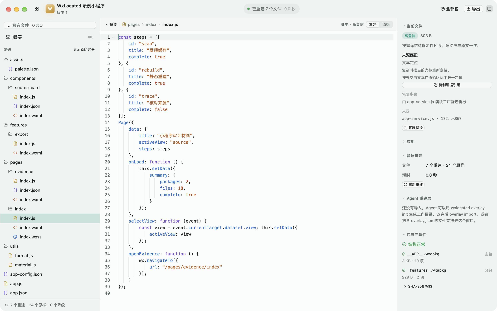

# WxLocated

基于 Rust + GPUI 的微信小程序本地工作台。定位缓存、解包解密、静态重建源码，并导出可追溯的审计材料。提供桌面端和面向 Agent 的 JSON CLI。

<a id="quick-start"></a>

## 下载与使用

| 系统 | 选择 |
| --- | --- |
| Windows 10/11 · Intel / AMD | x64 便携 ZIP |
| Windows 11 · ARM | ARM64 便携 ZIP |
| macOS 14+ · Apple Silicon / Intel | Universal DMG |

[下载最新版](https://github.com/bx33661/WxLocated/releases/latest)

Windows 解压后运行 `wxlocated-app.exe`，需要对应架构的 [VC++ 运行库](https://learn.microsoft.com/cpp/windows/latest-supported-vc-redist)。macOS 打开 DMG，将应用拖到“应用程序”。macOS 包采用 ad-hoc 签名，尚未公证。Windows EXE 未做 Authenticode 签名。

启动后从画廊打开已缓存的小程序，也可拖入 `.wxapkg` 文件或包目录。工作区支持核对缺失分包和插件、对照重建与原始内容、定位来源及导出材料。未找到缓存时，可在设置中添加缓存目录。



<a id="cli"></a>

## 命令行

在“设置 → Agent → 命令行工具”中安装，Windows 安装后重新打开终端。将示例 AppID 和材料目录替换为实际值。

```sh
wxlocated list
wxlocated info wx0123456789abcdef
wxlocated export wx0123456789abcdef --out ../materials --reuse --redact
wxlocated trace ../materials/wx0123456789abcdef-v1 app.js:42
```

业务命令输出 JSON，`watch` 输出 JSON Lines。可用 `--scan-path <目录>` 补充扫描路径，完整命令见 `wxlocated --help`。

<a id="materials"></a>

## 导出材料

- `raw/` 保存原始包，引用证据时以此为准。
- `source/` 保存静态重建源码与来源清单。
- `material.json` 记录完整度、包指纹与重建诊断，`AGENT.md` 说明如何使用材料。
- 已找到的插件和已导入的 Agent 重建层分别放在 `plugins/` 和 `semantic/`。

<a id="build"></a>
<a id="windows"></a>

## 源码构建

安装 [rustup](https://rustup.rs/)。macOS 需要 Xcode Command Line Tools，Windows 需要 MSVC C++ 构建工具和 Windows SDK，Release 构建还需要 SDK 的 `fxc.exe`。

```sh
cargo run -p wxlocated-app
cargo build --release -p wxlocated-cli
cargo test --workspace --locked
```

macOS 打包用 `./scripts/build-release.sh`。Windows x64 用 `./scripts/bundle-windows.ps1`，ARM64 加 `-Target aarch64-pc-windows-msvc`。 [Windows 验收清单](TODO-windows.md)

<a id="privacy"></a>

## 隐私

缓存只读，解析与重建均在本机完成，应用不执行包内代码。`--redact` 仅脱敏清单中的本机路径，导出源码仍可能含敏感信息。
