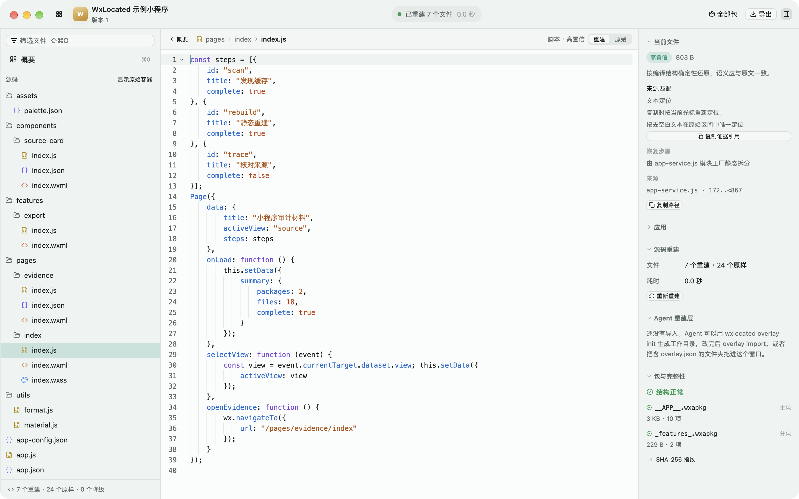

# WxLocated

基于 Rust + GPUI 的微信小程序本地工作台：定位缓存、解包解密、静态重建源码，导出带来源与 SHA-256 的审计材料，支持桌面查看和 Agent JSON CLI。

[](#quick-start)
[](Cargo.toml)
[](crates/wxlocated-app)

[快速开始](#quick-start) · [命令行](#cli) · [导出材料](#materials) · [构建](#build) · [隐私](#privacy)



## 主要能力

- 扫描微信多账户缓存，读取标准 `wxapkg` 与 `V1MMWX` 本地加密包。
- 合并主包与分包，检查缺失分包和插件。
- 恢复 JavaScript、WXML、WXS、WXSS 与配置，提取 Source Map 内嵌源码。
- 对照重建、原始与 Agent 视图，追溯来源并导出审计材料。

<a id="quick-start"></a>

## 快速开始

需要 **macOS 14+**、Xcode Command Line Tools 与 [rustup](https://rustup.rs/)。支持 Apple Silicon 和 Intel，当前通过源码构建使用。

```bash
git clone https://github.com/bx33661/WxLocated.git
cd WxLocated
cargo run -p wxlocated-app
```

启动后扫描缓存，打开小程序核对材料完整度、浏览源码，再选择“导出 → 导出审计材料”。也可直接拖入 `.wxapkg` 文件或包目录；缺失分包需在微信中访问对应页面触发下载。

<a id="cli"></a>

## 命令行

在“设置 → Agent → 命令行工具”中安装，或直接调用应用内的 `Contents/Helpers/wxlocated`。以下 AppID 为示例，使用时替换为扫描结果。

```bash
wxlocated list
wxlocated info wx0123456789abcdef
wxlocated export wx0123456789abcdef --out ../materials --reuse --redact
wxlocated trace ../materials/wx0123456789abcdef-v1 app.js:42
wxlocated --help
```

业务命令输出 JSON，`watch` 输出 JSON Lines；日志写入 stderr。Agent 可通过 `overlay init` / `overlay import` 创建、修改并导入语义化重建层。

<a id="materials"></a>

## 导出材料

```text
<appid>-v<版本>/
├── material.json       完整度、包指纹与重建诊断
├── AGENT.md            给 Agent 的材料说明
├── raw/                原始包副本
├── source/             静态重建源码与来源清单
├── plugins/<别名>/     已缓存的插件材料
└── semantic/<层名>/    已导入的 Agent 重建层
```

**证据以 `raw/` 为准。** 静态重建不能保证还原原始工程，Agent 重建层属于推断。可将材料交给 [MiniApp Audit Skills](https://github.com/bx33661/miniapp-audit-skills) 继续审计。

<a id="build"></a>

## 构建

```bash
cargo build --release -p wxlocated-cli  # target/release/wxlocated
./scripts/bundle-macos.sh              # target/bundle/WxLocated.app
cargo test --workspace
```

应用包默认包含 Apple Silicon 与 Intel 架构；可用 `ARCHS=aarch64` 或 `ARCHS=x86_64` 只构建单一架构。生成 DMG、PKG、ZIP 与校验文件使用 `./scripts/build-release.sh`。

<a id="privacy"></a>

## 数据与隐私

解析与重建均在本机完成，原始缓存只读；应用不执行包内代码，也不主动发送网络请求。设置和重建层存放在 `~/Library/Application Support/WxLocated/`，导出写入用户指定目录。

材料可能含本机信息，建议保存在仓库外。`--redact` 脱敏清单中的本机路径信息，不会清除源码内容。
